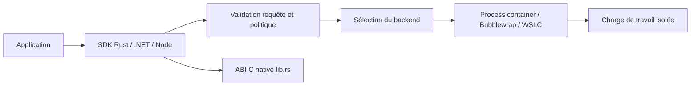

# microsoft/mxc

> Cross-platform sandbox SDK to run untrusted code coming from a model or a plugin.

## The problem
Running LLM-generated or plugin code on your machine risks exposing files, network and the graphical interface.

## What it actually does
Rust, .NET and Node SDK that validates a JSON container request (command, file, network and UI policies), picks an isolation backend and launches the workload. Backends: ProcessContainer, Windows Sandbox, LXC, Bubblewrap, Seatbelt, Nanvix MicroVM, Hyperlight, IsolationSession, WSLC. Persistent lifecycle and diagnostic tools for denied accesses.

## How it is wired


## Trying it
```bash
wxc-exec.exe --debug config.json
wxc-exec.exe --audit policy.json
./build.sh --all
```

## Cost and gotchas
Free. Prerequisites change depending on the backend; build from source with Rust 1.93 and Node 24. `--audit` disables all security, never use it with untrusted code. Optional telemetry, enabled only with consent.

## What it is not
Not a standalone product but a dependency to integrate. Each backend has its limits: network filtering varies by backend.

## Alternatives
- No alternative named in the README.

## For you
Keep an eye on it: a sandbox building block is useful for any agent that runs generated code. Young project, but backed by Microsoft, and to be evaluated on your target platform.
