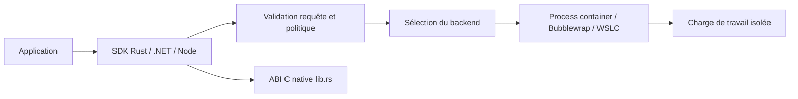

# microsoft/mxc

> SDK de bac à sable multi-plateforme pour exécuter du code non fiable issu d'un modèle ou d'un plugin.

## Le problème
Exécuter du code généré par un LLM ou un plugin sur sa machine risque d'exposer fichiers, réseau et interface graphique.

## Ce que ça fait vraiment
SDK Rust, .NET et Node qui valide une requête JSON de conteneur (commande, politiques fichiers, réseau, UI), choisit un backend d'isolation et lance la charge de travail. Backends : ProcessContainer, Windows Sandbox, LXC, Bubblewrap, Seatbelt, MicroVM Nanvix, Hyperlight, IsolationSession, WSLC. Cycle de vie persistant et outils de diagnostic des accès refusés.

## Comment c'est branché


## Essayer
```bash
wxc-exec.exe --debug config.json
wxc-exec.exe --audit policy.json
./build.sh --all
```

## Coût et pièges
Gratuit. Les prérequis changent selon le backend ; build depuis les sources avec Rust 1.93 et Node 24. `--audit` désactive toute la sécurité, ne jamais l'utiliser avec du code non fiable. Télémétrie optionnelle, activée seulement avec consentement.

## Ce que ce n'est pas
Pas un produit autonome mais une dépendance à intégrer. Chaque backend a ses limites : le filtrage réseau varie selon le backend.

## Alternatives
- Aucune alternative nommée dans le README.

## Pour toi
À surveiller : une brique de bac à sable est utile pour tout agent qui exécute du code généré. Projet jeune, mais soutenu par Microsoft, et à évaluer sur ta plateforme cible.

