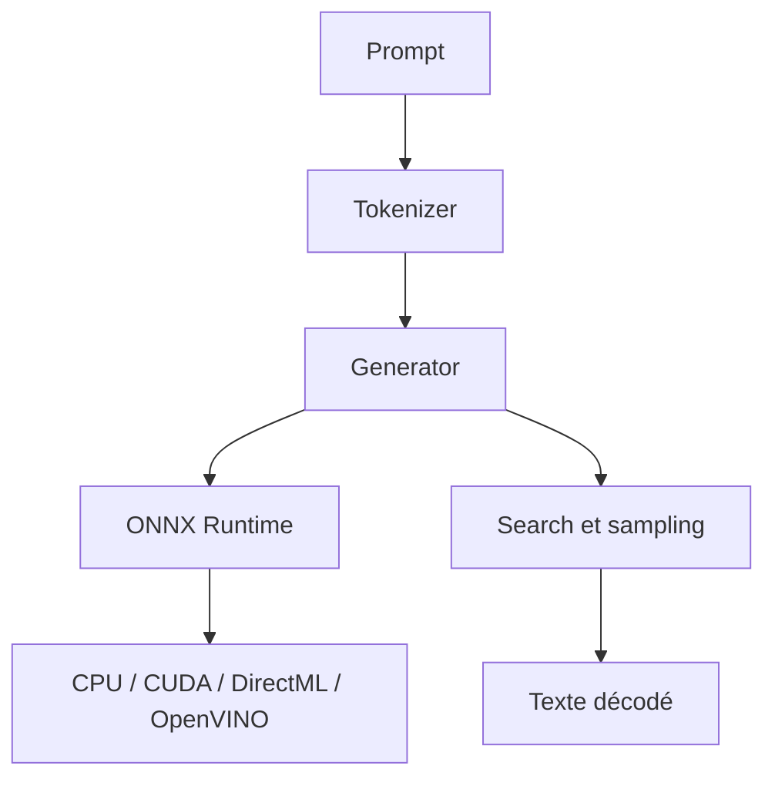

# microsoft/onnxruntime-genai

> Generative inference loop for ONNX models, to run LLMs on-device, in Python, C#, C++ or Java.

## The problem
Running an LLM locally means re-coding preprocessing, search, sampling and the KV cache around the inference engine.

## What it actually does
Implements the generation loop for ONNX models: tokenization, inference via ONNX Runtime, logits processing, sampling, KV cache management and grammars for tool calls. Supports many architectures (Llama, Phi, Qwen, Gemma, Whisper, etc.) and accelerators (CPU, CUDA, DirectML, OpenVINO, QNN, WebGPU). Handles multi-LoRA and constrained decoding.

## How it is wired
Simplified diagram based on the fiche, no diagram supplied.



## Trying it
```bash
huggingface-cli download microsoft/Phi-3-mini-4k-instruct-onnx --include cpu_and_mobile/cpu-int4-rtn-block-32-acc-level-4/* --local-dir .
pip install numpy
pip install --pre onnxruntime-genai
```

## Cost and gotchas
Free; you need to convert or download a model in ONNX format. Examples on `main` may differ from the published version. Java support requires building from source.

## What it is not
Not a multi-user inference server: it targets on-device execution. The README notes possible collection of usage data sent to Microsoft.

## Alternatives
No alternative named in the README.

## For you
Adopt if you deploy LLMs on desktops or mobile in the ONNX ecosystem: active Microsoft project, wide hardware support.
