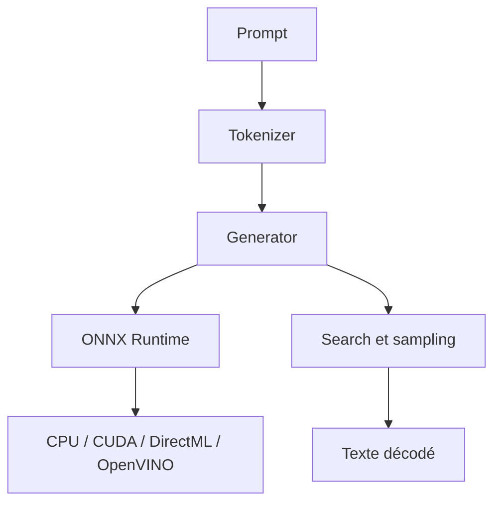

# microsoft/onnxruntime-genai

> Boucle d'inférence générative pour modèles ONNX, à exécuter des LLM sur appareil, en Python, C#, C++ ou Java.

## Le problème
Faire tourner un LLM localement demande de recoder prétraitement, recherche, échantillonnage et cache KV autour du moteur d'inférence.

## Ce que ça fait vraiment
Implémente la boucle de génération pour modèles ONNX : tokenisation, inférence via ONNX Runtime, traitement des logits, sampling, gestion du cache KV et grammaires pour appels d'outils. Prend en charge de nombreuses architectures (Llama, Phi, Qwen, Gemma, Whisper, etc.) et des accélérateurs (CPU, CUDA, DirectML, OpenVINO, QNN, WebGPU). Gère multi-LoRA et décodage contraint.

## Comment c'est branché
Schéma simplifié d'après la fiche, sans diagramme fourni.



## Essayer
```bash
huggingface-cli download microsoft/Phi-3-mini-4k-instruct-onnx --include cpu_and_mobile/cpu-int4-rtn-block-32-acc-level-4/* --local-dir .
pip install numpy
pip install --pre onnxruntime-genai
```

## Coût et pièges
Gratuit ; il faut convertir ou télécharger un modèle au format ONNX. Les exemples de `main` peuvent différer de la version publiée. Le support Java demande une compilation depuis les sources.

## Ce que ce n'est pas
Pas un serveur d'inférence multi-utilisateurs : cible l'exécution sur appareil. Le README signale une collecte possible de données d'usage envoyées à Microsoft.

## Alternatives
Aucune alternative nommée dans le README.

## Pour toi
À adopter si tu déploies des LLM sur poste ou mobile dans l'écosystème ONNX : projet Microsoft actif, large support matériel.

