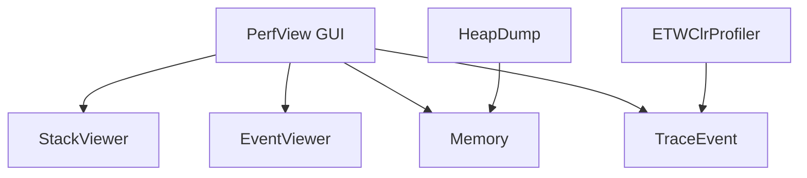

# microsoft/perfview

> Windows tool for CPU and memory performance analysis, centered on the .NET runtime.

## The problem
Understanding why a .NET application is slow or memory-hungry, from system traces.

## What it actually does
PerfView collects and analyzes ETW and EventPipe traces: CPU stacks, allocations, garbage collector heaps, events. It is built on the TraceEvent library, which can be used separately. It includes native projects (CLR profiler, heap dump) and an analysis interface. Partial support exists for Linux data.

## How it is wired
Simplified diagram based on the sheet, no diagram provided.


## Trying it
```bash
build.cmd
build.cmd -Configuration Release
```

## Cost and gotchas
Free. Windows 10 or later and .NET Framework 4.7.2. To build: Visual Studio 2026 with C++ and .NET workloads. No native ARM64 version.

## What it is not
Not a Python or GPU profiler. It targets .NET.

## Alternatives
No alternative named in the README.

## For you
Ignore: a .NET performance tool for Windows, unrelated to your data and AI pipelines.
