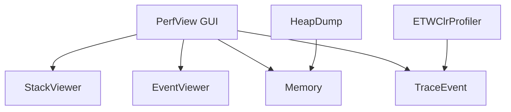

# microsoft/perfview

> Outil Windows d'analyse des performances CPU et mémoire, centré sur le runtime .NET.

## Le problème
Comprendre pourquoi une application .NET est lente ou gourmande en mémoire, à partir de traces système.

## Ce que ça fait vraiment
PerfView collecte et analyse des traces ETW et EventPipe : piles CPU, allocations, tas du ramasse-miettes, événements. Il repose sur la bibliothèque TraceEvent, utilisable séparément. Il comprend des projets natifs (profileur CLR, dump de tas) et une interface d'analyse. Un support partiel existe pour des données Linux.

## Comment c'est branché
Schéma simplifié d'après la fiche, sans diagramme fourni.


## Essayer
```bash
build.cmd
build.cmd -Configuration Release
```

## Coût et pièges
Gratuit. Windows 10 ou plus et .NET Framework 4.7.2. Pour compiler : Visual Studio 2026 avec charges de travail C++ et .NET. Pas de version ARM64 native.

## Ce que ce n'est pas
Pas un profileur Python ni GPU. Il vise le .NET.

## Alternatives
Aucune alternative nommée dans le README.

## Pour toi
Ignorer : outil de performance .NET sous Windows, sans lien avec tes pipelines data et IA.

