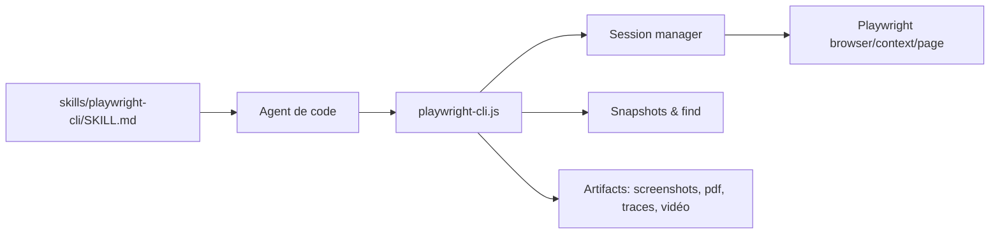

# microsoft/playwright-cli

> Playwright CLI with skills for coding agents, which drives a browser without saturating the context.

## The problem
Coding agents that drive a browser through MCP load large tool schemas and accessibility trees, which consumes tokens.

## What it actually does
Short commands (`open`, `click`, `type`, `snapshot`, `screenshot`, `route`, `tracing-start`…) that act on a named browser session. Snapshots are written to files rather than into the context; `find` searches within them. Persistent or in-memory sessions, attaching to Chrome via CDP, a `show` dashboard, skills installable for Claude Code and Copilot.

## How it is wired


## Trying it
```bash
npm install -g @playwright/cli@latest
playwright-cli install --skills
playwright-cli open https://playwright.dev --headed
```

## Cost and gotchas
Free; Node.js 18+. A session with no commands stops after one hour. WebMCP tools exposed by a page are untrusted inputs.

## What it is not
Not a replacement for MCP: the README judges it preferable for persistent-state loops. Not a testing framework in itself.

## Alternatives
Playwright MCP, cited in the README, for agent loops with persistent state.

## For you
Adopt: gives a coding agent token-efficient browser control, under Apache-2.0 and backed by Microsoft.
