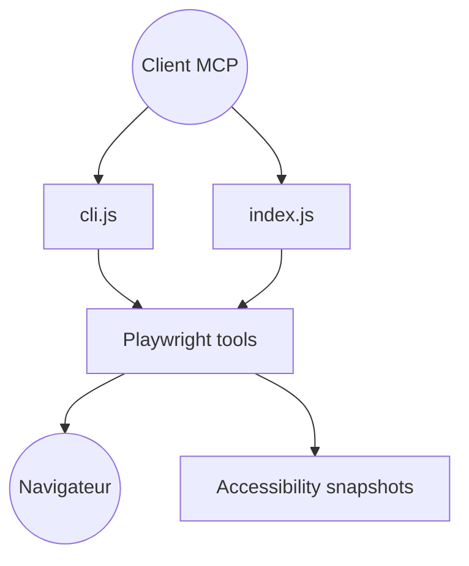

# microsoft/playwright-mcp

> MCP server that lets an agent drive a browser through accessibility snapshots.

## The problem
An agent that automates the web through screenshots is slow and ambiguous.

## What it actually does
Exposes navigation, interactions, accessibility snapshots, network, storage, DevTools, PDF and coordinates (vision option). Persistent profile, isolated mode or browser extension; secrets masked and origins allowlistable in the configuration.

## How it is wired


## Trying it
```bash
claude mcp add playwright npx @playwright/mcp@latest
npx @playwright/mcp@latest --config path/to/config.json
```

## Cost and gotchas
Free; browser to install. A persistent profile serves only one client at a time (otherwise `--isolated`). The README warns that `--allowed-origins` is not a security boundary.

## What it is not
Not a test suite. The README recommends the CLI with skills to save tokens.

## Alternatives
The Playwright CLI with skills, cited in the README.

## For you
Worth adopting to give a browser to a development agent, with structured snapshots and no vision model.
