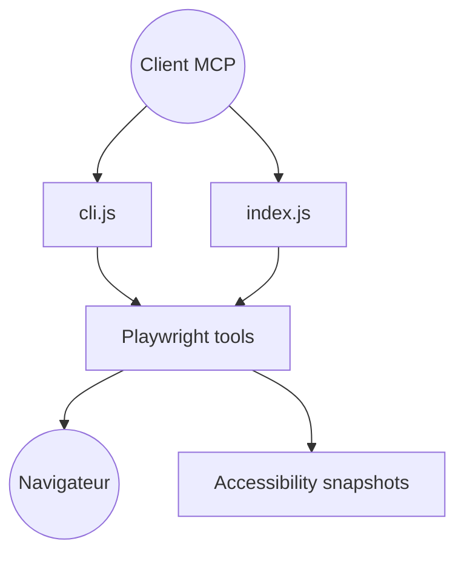

# microsoft/playwright-mcp

> Serveur MCP qui laisse un agent piloter un navigateur via des instantanés d'accessibilité.

## Le problème
Un agent qui automatise le web par captures d'écran est lent et ambigu.

## Ce que ça fait vraiment
Expose navigation, interactions, instantanés d'accessibilité, réseau, stockage, DevTools, PDF et coordonnées (option vision). Profil persistant, mode isolé ou extension de navigateur ; secrets masqués et origines autorisables dans la configuration.

## Comment c'est branché


## Essayer
```bash
claude mcp add playwright npx @playwright/mcp@latest
npx @playwright/mcp@latest --config path/to/config.json
```

## Coût et pièges
Gratuit ; navigateur à installer. Un profil persistant ne sert qu'à un client à la fois (`--isolated` sinon). Le README signale que `--allowed-origins` n'est pas une frontière de sécurité.

## Ce que ce n'est pas
Pas une suite de tests. Le README recommande la CLI avec skills pour économiser les tokens.

## Alternatives
La CLI Playwright avec skills, citée dans le README.

## Pour toi
À adopter pour donner un navigateur à un agent de développement, avec instantanés structurés sans modèle de vision.

