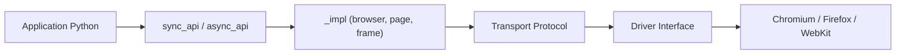

# microsoft/playwright-python

> Python binding of Playwright to drive Chromium, Firefox and WebKit, with a synchronous or asynchronous API.

## The problem
Testing or automating web pages reliably across several browsers without handling each protocol by hand.

## What it actually does
Exposes a Playwright API in Python: launch a browser, open a page, navigate, take a screenshot, simulate typing and network. Two facades (`sync_api`, `async_api`) share a single `_impl` implementation, which talks to a driver through a transport channel; the driver controls the browser engines.

## How it is wired


## Trying it
The README documents no shell command; it only gives this example:
```python
from playwright.sync_api import sync_playwright

with sync_playwright() as p:
    for browser_type in [p.chromium, p.firefox, p.webkit]:
        browser = browser_type.launch()
        page = browser.new_page()
        page.goto('http://playwright.dev')
        page.screenshot(path=f'example-{browser_type.name}.png')
        browser.close()
```

## Cost and gotchas
Free. Browser installation is not described in the README (see the online documentation). Scripts launch real browsers: plan for CPU and memory in CI.

## What it is not
Not a turnkey scraping tool nor a hosted testing service: it is a driving library, to integrate into your code or your testing framework.

## Alternatives
The README cites the same libraries in other languages: Node.js, .NET and Java.

## For you
Adopt: the reference for automating a browser from Python (testing model interfaces, collecting pages), backed by Microsoft and closely followed (16 open issues).
