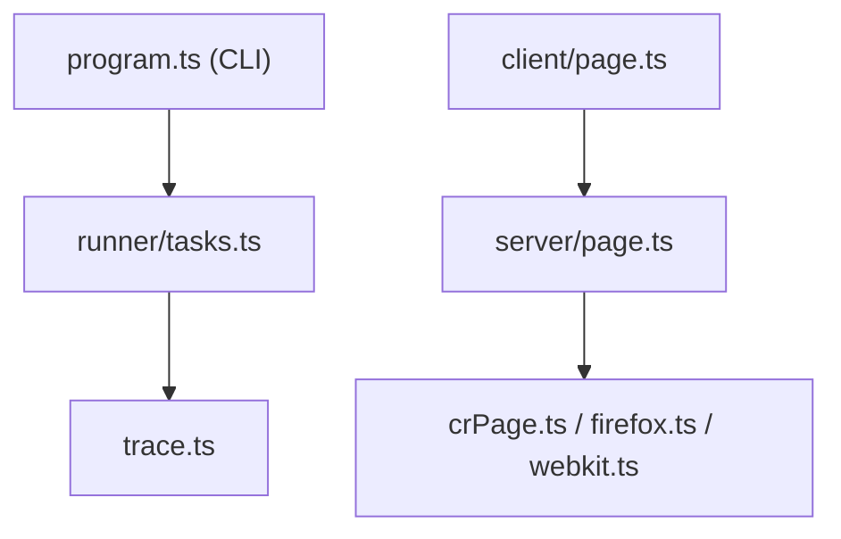

# microsoft/playwright

> Multi-browser web automation and testing framework (Chromium, Firefox, WebKit), also controllable by AI agents.

## The problem
Testing or automating a website across multiple browsers with fragile expectations results in unstable tests.

## What it actually does
A single API controls all three browsers with automatic waiting, role-based localization, isolated contexts, logging, and HTML reporting. The repository also includes a command-line interface (CLI) for code agents, an MCP server (accessibility snapshots), a script library (capture, PDF generation, mobile emulation, network interception), and a VS Code extension.

## How it is wired


## Trying it
```bash
npm init playwright@latest
npx playwright test
npx playwright show-trace trace.zip
claude mcp add playwright npx @playwright/mcp@latest
```

## Cost and gotchas
Free. Download the browsers (`npx playwright install`), which requires a significant amount of disk space. The agent tools (CLI, MCP) are documented as separate methods.

## What it is not
This is not a ready-made scraping tool or a load testing tool. The CLI agent is not a replacement for the MCP server: the documentation presents them as separate options.

## Alternatives
No alternative is specified in the README file.

## For you
Recommended: Use a standard method for testing a model interface or provide a well-maintained and documented browser for an agent.
