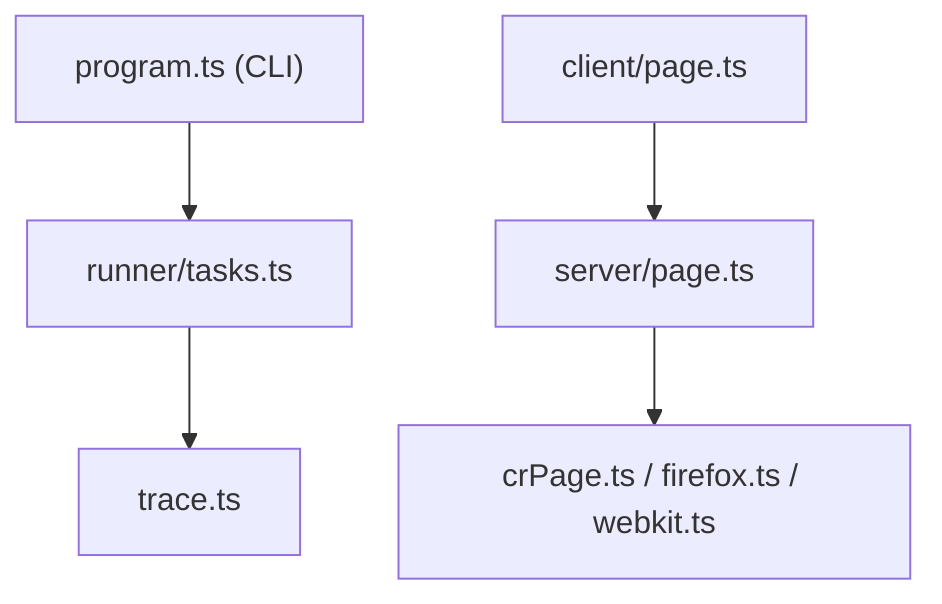

# microsoft/playwright

> Framework d'automatisation et de test web multi-navigateurs (Chromium, Firefox, WebKit), aussi pilotable par des agents IA.

## Le problème
Tester ou automatiser un site sur plusieurs navigateurs avec des attentes fragiles produit des tests instables.

## Ce que ça fait vraiment
Une API unique pilote les trois navigateurs avec attente automatique, localisateurs par rôle, contextes isolés, traces et rapport HTML. Le dépôt propose aussi un CLI pour agents de code, un serveur MCP (snapshots d'accessibilité), une bibliothèque de scripts (capture, PDF, émulation mobile, interception réseau) et une extension VS Code.

## Comment c'est branché


## Essayer
```bash
npm init playwright@latest
npx playwright test
npx playwright show-trace trace.zip
claude mcp add playwright npx @playwright/mcp@latest
```

## Coût et pièges
Gratuit. Télécharge les navigateurs (`npx playwright install`), espace disque non négligeable. Les outils agents (CLI, MCP) sont documentés comme voies distinctes.

## Ce que ce n'est pas
Pas un outil de scraping clé en main ni de test de charge. Le CLI agent n'est pas un remplacement du serveur MCP : le README les présente comme options.

## Alternatives
Aucune alternative nommée dans le README.

## Pour toi
À adopter : standard pour tester une interface de modèle ou donner un navigateur à un agent, bien maintenu et documenté.

