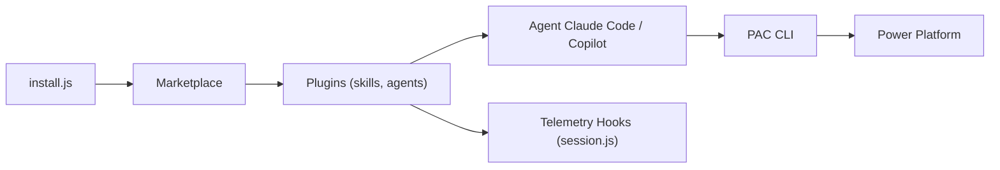

# microsoft/power-platform-skills

> Claude Code / Copilot CLI plugin marketplace for generating Power Platform apps, sites and flows.

## The problem
Building Power Pages, Power Apps or Power Automate apps by hand means juggling PAC CLI, schemas and deployment.

## What it actually does
Eight plugins (power-pages, model-apps, mcp-apps, code-apps, mobile-apps, power-apps-mobile-extension, canvas-apps, power-automate) provide skills, agents and commands. The user describes their intent in natural language, the agent generates then deploys through PAC CLI. Code support is only visible for mobile, model-apps and Power Pages; the rest is described by the README alone.

## How it is wired


## Trying it
```bash
curl -fsSL https://raw.githubusercontent.com/microsoft/power-platform-skills/main/scripts/install.js | node
/plugin marketplace add microsoft/power-platform-skills
/plugin install power-pages@power-platform-skills
```

## Cost and gotchas
You need a Power Platform environment (licenses not detailed in the README) and the `pac` CLI; canvas-apps requires .NET 10, power-automate Node 18+ and `az login`. Power Pages telemetry is on by default (organization and tenant GUIDs, possibly the user's Entra ID); disable it with `/power-pages:telemetry off`.

## What it is not
Not a general-purpose tool: everything is tied to the Microsoft Power Platform ecosystem. The README's "uninterrupted" mode gives the agent the same access as you: reserve it for trusted environments. 130 open issues.

## Alternatives
No alternative cited in the README.

## For you
Ignore unless your team builds on Power Platform: it is neither data nor MLOps, and the default telemetry is worth knowing about.
