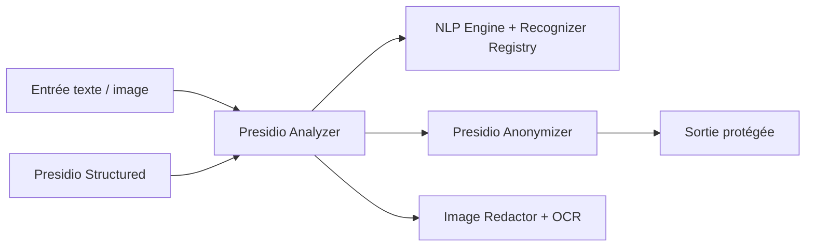

# microsoft/presidio

> SDK for detecting and anonymizing personal data in text and images.

## The problem
Spotting and masking personal data (cards, names, numbers, wallets) before sharing or training on a dataset.

## What it actually does
Four components: Analyzer (detection via NER recognizers, regular expressions, rules, checksums and context, in several languages), Anonymizer (replacement, masking, hashing, encryption operators), Image Redactor (OCR, standard and DICOM images) and Structured (tabular data). Usable in Python, PySpark, Docker or Kubernetes; external models can be plugged in.

## How it is wired

## Trying it
The README gives no command: it points to "Using pip", "Using Docker" and "From source" in the documentation.

## Cost and gotchas
Free. The README warns that automatic detection is not exhaustive: plan for other safeguards. The README notes that the project has moved to data-privacy-stack/presidio.

## What it is not
Not a compliance guarantee (GDPR or otherwise): it is a probabilistic detection tool. The indexed repository may no longer be the place of active development.

## Alternatives
No alternative named in the README.

## For you
Adopt it to purge data before training or sharing, checking where development now lives.
