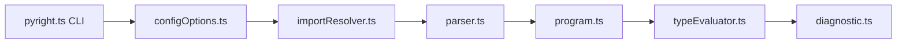

# microsoft/pyright

> Static type checker for Python, as a command-line tool and VS Code extension.

## The problem
Python type errors only appear at runtime; a fast checker is needed on large repositories.

## What it actually does
Loads the configuration, resolves imports, parses the sources, evaluates types and emits diagnostics. Shipped as a CLI and a VS Code extension (language server with editing features), with a type server and notebook support. A weekly benchmark against other checkers and an online playground are mentioned. The `PYRIGHT_TMPDIR` variable sets the temporary folder.

## How it is wired


## Trying it
```bash
# Aucune commande d'installation dans le README fourni
# (renvoi vers la documentation) ; seule variable : PYRIGHT_TMPDIR=<dossier>.
```

## Cost and gotchas
Free. A license is present but not identified by GitHub: check it in the repository. It is one of the tools launched from Node.

## What it is not
Not a formatter or a style linter; it does not replace tests.

## Alternatives
No alternative named in the README (benchmark against other checkers, not named here).

## For you
Very relevant for making Python data/ML code more reliable in CI and in VS Code; adopt after confirming the license.
