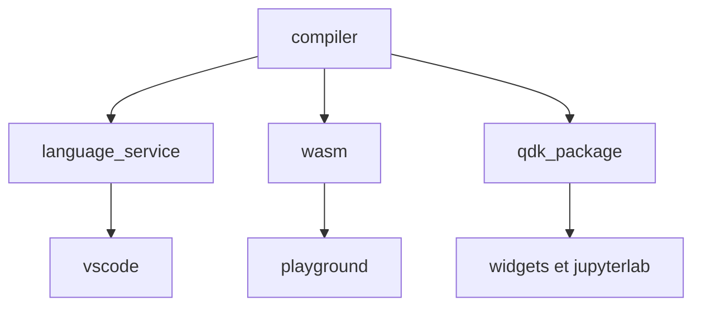

# microsoft/qdk

> Microsoft development kit for the Q# language: compiler, VS Code and Jupyter extensions, resource estimator.

## The problem
Programming quantum algorithms in Q# requires a compiler, an editor, a standard library and estimation tools.

## What it actually does
The repository brings together the compiler, the language service, the Q# standard library, the npm package, the web playground, the `qdk` Python package (native Rust extension), the resource estimator, the VS Code extension, the WebAssembly module and the Jupyter widgets. Tutorials (katas) and examples are provided.

## How it is wired
Simplified diagram based on the sheet, no diagram provided.



## Trying it
```shell
rustup target add wasm32-unknown-unknown
python ./prereqs.py --install
python ./build.py
```

## Cost and gotchas
Free. Building requires Python, Rust (wasm32 target), Node.js, a C compiler, wasm-bindgen and wasm-opt. The README gives no installation instructions for the `qdk` package alone.

## What it is not
Not a generic AI tool nor a quantum computer: a development environment for Q#.

## Alternatives
No alternative named in the README.

## For you
Worth watching: relevant only if you are exploring quantum computing; otherwise it has no effect on your day-to-day work.
