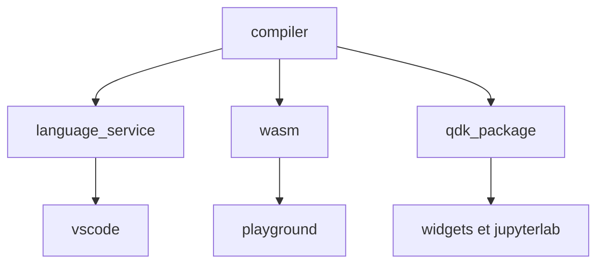

# microsoft/qdk

> Kit de développement Microsoft pour le langage Q# : compilateur, extensions VS Code et Jupyter, estimateur de ressources.

## Le problème
Programmer des algorithmes quantiques en Q# demande compilateur, éditeur, bibliothèque standard et outils d'estimation.

## Ce que ça fait vraiment
Le dépôt regroupe le compilateur, le service de langage, la bibliothèque standard Q#, le paquet npm, le terrain de jeu web, le paquet Python `qdk` (extension native Rust), l'estimateur de ressources, l'extension VS Code, le module WebAssembly et les widgets Jupyter. Des tutoriels (katas) et exemples sont fournis.

## Comment c'est branché
Schéma simplifié d'après la fiche, sans diagramme fourni.



## Essayer
```shell
rustup target add wasm32-unknown-unknown
python ./prereqs.py --install
python ./build.py
```

## Coût et pièges
Gratuit. La compilation exige Python, Rust (cible wasm32), Node.js, un compilateur C, wasm-bindgen et wasm-opt. Le README ne donne pas d'installation du paquet `qdk` seul.

## Ce que ce n'est pas
Pas un outil d'IA générique ni un ordinateur quantique : un environnement de développement pour Q#.

## Alternatives
Aucune alternative nommée dans le README.

## Pour toi
À surveiller : pertinent seulement si tu explores le calcul quantique ; sinon sans effet sur ton quotidien.

