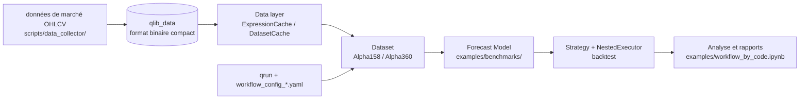

# microsoft/qlib

> **One sentence.** AI-oriented quantitative investment Python platform, for quant researchers and finance data scientists.

## The problem

Without it, a quant researcher rewrites the same pipeline every time: ingesting heterogeneous market data, building features, training, backtesting, analysis. The README notes that general-purpose databases (MySQL, MongoDB, InfluxDB, HDF5) spend too much time loading data because of interface layers and format conversions.

## What it actually does

Qlib covers the full chain: data processing, model training, backtesting, then alpha seeking, risk modeling, portfolio optimization and order execution. It provides data storage in its own compact format, with `ExpressionCache` and `DatasetCache`. It ships a model zoo (XGBoost, LightGBM, CatBoost, MLP, LSTM, GRU, ALSTM, GATs, SFM, TFT, TabNet, DoubleEnsemble, TCTS, Transformer, Localformer, TRA, TCN, ADARNN, ADD, IGMTF, HIST, KRNN, Sandwich), two feature sets (`Alpha158`, `Alpha360`), a market dynamics adaptation component (Rolling Retraining, DDG-DA) and a reinforcement learning framework for order execution (TWAP, PPO, OPDS). The components are described as loosely coupled modules, each usable on its own.

## How it is wired



No diagram drawn from the code for this repository: this chart is reconstructed from the README. Control goes either through `qrun` and a YAML workflow file, or through a `workflow_by_code` script. The data server has an `Offline` mode (default, local) and an `Online` mode (shared service, code in microsoft/qlib-server).

## Trying it

```bash
pip install pyqlib
```

```bash
wget https://github.com/chenditc/investment_data/releases/latest/download/qlib_bin.tar.gz
mkdir -p ~/.qlib/qlib_data/cn_data
tar -zxvf qlib_bin.tar.gz -C ~/.qlib/qlib_data/cn_data --strip-components=1
rm -f qlib_bin.tar.gz
```

```bash
cd examples  # Avoid running program under the directory contains `qlib`
qrun benchmarks/LightGBM/workflow_config_lightgbm_Alpha158.yaml
```

## Cost and gotchas

Free, no API key. Python 3.8 to 3.12, conda recommended. The main pitfall is the data: the README states "Due to more restrict data security policy. The official dataset is disabled temporarily" and points to a community-contributed dataset. The official data comes from Yahoo Finance and the README warns it "might not be perfect". The provided offline dataset cannot be updated incrementally: you must start over from the yahoo collector. `run_all_model.py` only runs on Linux, each baseline has its own dependencies (TFT requires Python 3.6~3.7 because of `tensorflow==1.15.0`), and the `group_key` change between pandas 1.5 and 2.0 breaks several examples listed by name. A Docker image exists: `docker pull pyqlib/qlib_image_stable:stable`.

## What it is not

Not a trading terminal nor a broker: nothing executes a real order, the chain stops at backtesting and analysis. Nor is it a data provider — the official dataset is disabled and you have to bring your own. It is not an LLM-driven factor factory: that part lives in a separate repository, RD-Agent. And the return figures shown in the README are the output of an example, not a performance promise.

## Alternatives

- **microsoft/RD-Agent**, cited by the README: for LLM-driven factor research and model optimization, as a complement and not a replacement for Qlib.
- **microsoft/qlib-server**, cited by the README: take it if the need is a shared data service rather than the local offline mode.
- **firmai/financial-machine-learning** among the neighbors: a list of finance ML resources, useful for exploring the field, not an executable framework.

## For you

Interesting if the subject is quantitative finance: the full pipeline, the model zoo and the data format are worth reading, even just to draw inspiration from the architecture. Outside that field, the foundation is too specialized. Watch rather than adopt blindly: the latest version announced in the README is v0.9.0 (Dec. 2022) and the official dataset is unavailable, so getting started depends on a community source.
