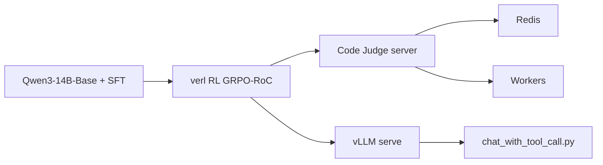

# microsoft/rStar

> Code for rStar2-Agent: agentic RL with code execution for a 14B math model.

## The problem
Training a reasoning model that calls code tools is expensive in rollouts and GPUs. The paper claims a more economical method.

## What it actually does
The README covers three things: chatting with the model via vLLM and a Code Judge server (Redis + workers that execute the generated Python), evaluating on AIME24/25 and MATH500, and launching RL training (GRPO-RoC) on verl v0.5 with Qwen3-14B-Base. It states that this migrated framework has not yet been used to train a full model (first 50 steps verified).

## How it is wired


## Trying it
```bash
git submodule init && git submodule update
pip install "torch<2.8"
pip install -r verl/requirements_sglang.txt
pip install -e verl
pip install -r code-judge/requirements.txt && pip install -e code-judge
pip install -e .
vllm serve /path/to/your/model --host 0.0.0.0 --port 8000 --enable-auto-tool-choice --tool-call-parser hermes
MODEL_PATH=/path/to/your/model bash examples/aime_eval.sh
```

## Cost and gotchas
Training is planned for 8 A100/H100 GPUs; the paper cites 64 MI300X. Code Judge executes arbitrary code: Docker and isolated network, never exposed. The README's Redis server is launched with `--protected-mode no --bind 0.0.0.0`.

## What it is not
Not a model ready to download here, nor an end-to-end validated reproduction. The supplied architecture graph describes an MCTS pipeline (rStar-Math) that does not match the README: the two coexist without explanation.

## Alternatives
No alternative named; the repository builds on verl and Code Judge.

## For you
Watch: useful for understanding agentic RL with tools, but the published framework is not validated on a full training run.
