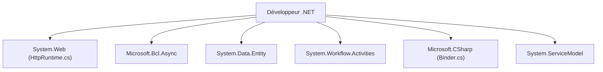

# microsoft/referencesource

> Read-only reference sources of the .NET Framework, for .NET developers who want to read the code.

## The problem
Understanding the exact behavior of a .NET Framework class without being able to read its implementation.

## What it actually does
A read-only subset of the .NET Framework code: ASP.NET (System.Web), async compatibility, data access, workflow, the C# dynamic binder, XML serialization, networking. No feature requests or bug reports are accepted here.

## How it is wired

## Trying it
No command: you browse the sources. Nothing to run.

## Cost and gotchas
Free. The last push dates from October 2025; the repository is frozen and only reflects the .NET Framework, not modern .NET.

## What it is not
Neither a library to reference, nor a living project, nor a place to report bugs.

## Alternatives
- .NET Core: the living code, which this repository only serves to consult.

## For you
Ignore: browsing historical .NET Framework code, unrelated to a data, AI or MLOps profile.
