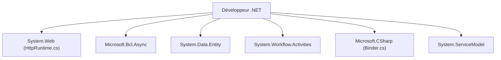

# microsoft/referencesource

> Sources de référence du .NET Framework en lecture seule, pour les développeurs .NET qui veulent lire le code.

## Le problème
Comprendre le comportement exact d'une classe du .NET Framework sans pouvoir lire son implémentation.

## Ce que ça fait vraiment
Un sous-ensemble en lecture seule du code du .NET Framework : ASP.NET (System.Web), compatibilité async, accès aux données, workflow, binder dynamique C#, sérialisation XML, réseau. Aucune demande de fonctionnalité ni de bug acceptée ici.

## Comment c'est branché

## Essayer
Aucune commande : on parcourt les sources. Rien à exécuter.

## Coût et pièges
Gratuit. Le dernier push date d'octobre 2025 ; le dépôt est figé et ne reflète que le .NET Framework, pas .NET moderne.

## Ce que ce n'est pas
Ni une bibliothèque à référencer, ni un projet vivant, ni un lieu pour signaler des bugs.

## Alternatives
- .NET Core : le code vivant, que ce dépôt sert seulement à consulter.

## Pour toi
Ignorer : consultation de code .NET Framework historique, sans lien avec un profil data, IA ou MLOps.

