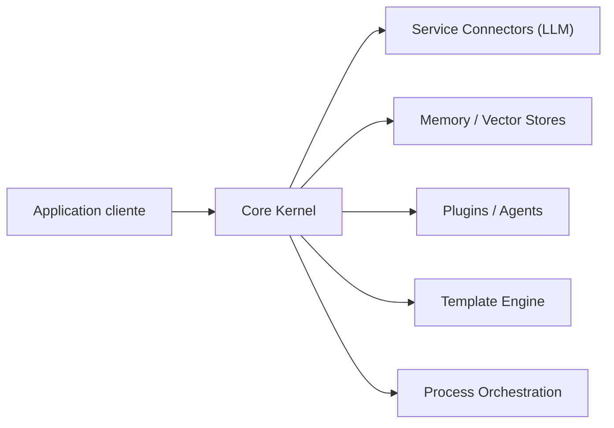

# microsoft/semantic-kernel

> Microsoft SDK for agents and multi-agent systems, now replaced by Microsoft Agent Framework.

## The problem
Orchestrating LLMs, tools and memories in an app takes a lot of repetitive code.

## What it actually does
Python, .NET and Java SDK: conversational agents with plugins (native functions, prompt templates, OpenAPI, MCP), model connectors (OpenAI, Azure OpenAI, Hugging Face, Ollama, ONNX), vector databases, a process framework and multi-agent systems. The README announces that Microsoft Agent Framework 1.0 is its successor.

## How it is wired


## Trying it
```bash
export AZURE_OPENAI_API_KEY=AAA....
export OPENAI_API_KEY=sk-...
pip install semantic-kernel
dotnet add package Microsoft.SemanticKernel
```

## Cost and gotchas
Model calls are billed by the provider. The README's warning says the project is giving way to Agent Framework: risk of reduced maintenance.

## What it is not
Not the product to prefer for a new project, according to the README itself.

## Alternatives
Microsoft Agent Framework, the successor cited by the README.

## For you
Keep an eye on it: use it only for existing code; for a new project, start from the announced successor.
