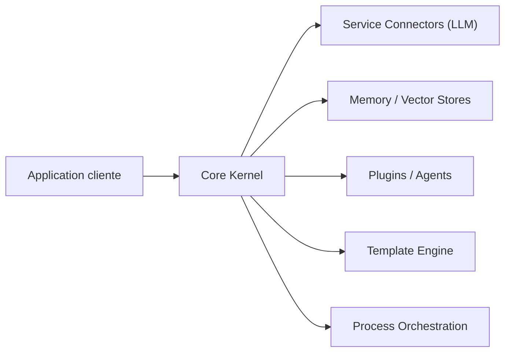

# microsoft/semantic-kernel

> SDK Microsoft pour agents et systèmes multi-agents, désormais remplacé par Microsoft Agent Framework.

## Le problème
Orchestrer des LLM, des outils et des mémoires dans une appli demande beaucoup de code répétitif.

## Ce que ça fait vraiment
SDK Python, .NET et Java : agents de conversation avec plugins (fonctions natives, modèles de prompts, OpenAPI, MCP), connecteurs de modèles (OpenAI, Azure OpenAI, Hugging Face, Ollama, ONNX), bases vectorielles, un framework de processus et des systèmes multi-agents. Le README annonce que Microsoft Agent Framework 1.0 en est le successeur.

## Comment c'est branché


## Essayer
```bash
export AZURE_OPENAI_API_KEY=AAA....
export OPENAI_API_KEY=sk-...
pip install semantic-kernel
dotnet add package Microsoft.SemanticKernel
```

## Coût et pièges
Les appels aux modèles sont facturés par le fournisseur. L'avertissement du README indique que le projet cède la place à Agent Framework : risque de maintenance réduite.

## Ce que ce n'est pas
Pas le produit à privilégier pour un nouveau projet selon le README lui-même.

## Alternatives
Microsoft Agent Framework, successeur cité par le README.

## Pour toi
À surveiller : à n'utiliser que pour du code existant ; pour un nouveau projet, pars du successeur annoncé.

