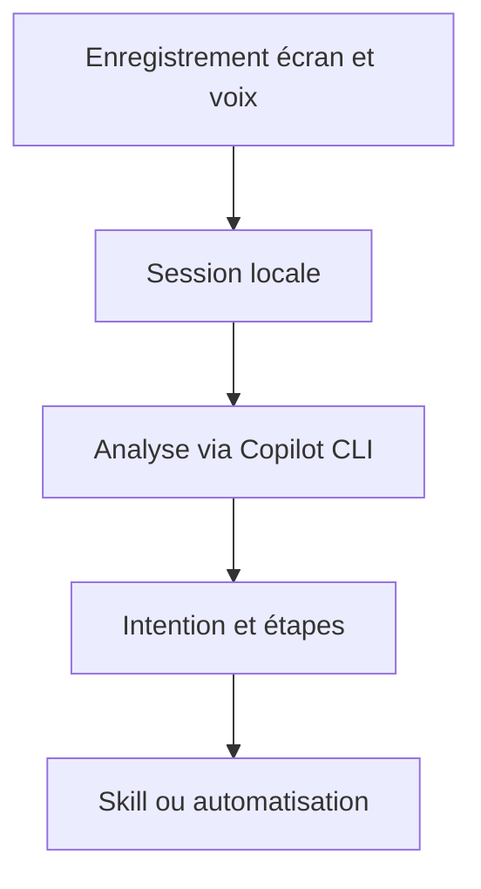

# microsoft/skill-recorder

> Records a task on screen to turn it into a reusable skill or automation for an agent.

## The problem
Writing out by hand the procedure of a repetitive task for an AI agent is slow and imprecise.

## What it actually does
Electron application that captures screen, windows, URLs, clipboard, optional terminal and voice (transcribed locally with Whisper). On request, it sends a filtered excerpt to GitHub Copilot CLI, which reconstructs an intent and ordered steps, then generates a `SKILL.md` or an automation. It can also import an MP4 or WebM video.

## How it is wired
Simplified diagram based on the sheet, no diagram provided.



## Trying it
```bash
npm ci
npm run compliance:licenses
npm run dev
```
For installation, copy the "Commit-pinned installation" command from the release page.

## Cost and gotchas
A GitHub account with Copilot access is required. The analysis sends data (titles, URLs, images, text) to GitHub's cloud: never record secrets. Video import is memory-hungry (about 4.6 GB measured).

## What it is not
Not a 100% local capture: the Analyze step leaves the machine. The SKILL.md preview is not a security guarantee.

## Alternatives
No alternative named in the README.

## For you
Worth watching: a good idea for industrializing agent skills, but data is sent to GitHub Copilot and the first measurements were made on Windows ARM64.
