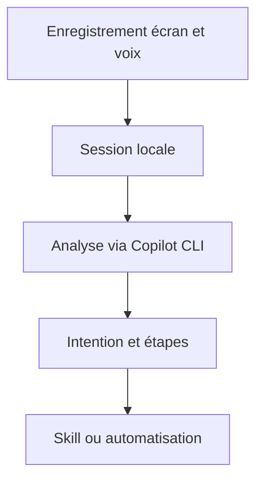

# microsoft/skill-recorder

> Enregistre une tâche à l'écran pour la convertir en skill ou automatisation réutilisable par un agent.

## Le problème
Écrire à la main la procédure d'une tâche répétitive pour un agent IA est long et imprécis.

## Ce que ça fait vraiment
Application Electron qui capture écran, fenêtres, URL, presse-papiers, terminal optionnel et voix (transcrite localement avec Whisper). Sur demande, envoie un extrait filtré à GitHub Copilot CLI, qui reconstruit une intention et des étapes ordonnées, puis génère un `SKILL.md` ou une automatisation. Peut aussi importer une vidéo MP4 ou WebM.

## Comment c'est branché
Schéma simplifié d'après la fiche, sans diagramme fourni.



## Essayer
```bash
npm ci
npm run compliance:licenses
npm run dev
```
Pour l'installation, copier la commande « Commit-pinned installation » de la page de release.

## Coût et pièges
Compte GitHub avec accès Copilot requis. L'analyse envoie des données (titres, URL, images, texte) au cloud de GitHub : ne jamais enregistrer de secrets. Import vidéo gourmand en mémoire (environ 4,6 Go mesurés).

## Ce que ce n'est pas
Pas une capture 100 % locale : l'étape Analyze quitte la machine. L'aperçu du SKILL.md n'est pas une garantie de sécurité.

## Alternatives
Aucune alternative nommée dans le README.

## Pour toi
À surveiller : bonne idée pour industrialiser des skills d'agents, mais envoi de données vers GitHub Copilot et premières mesures faites sur Windows ARM64.

