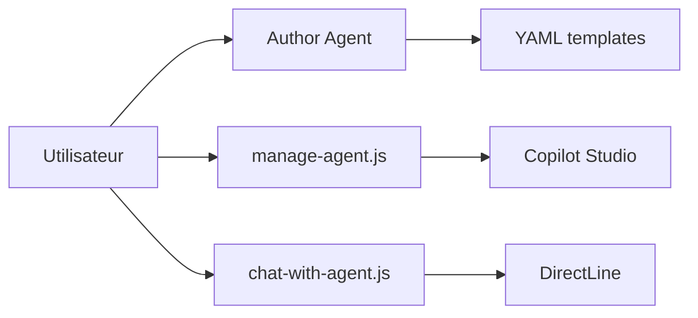

# microsoft/skills-for-copilot-studio

> Claude Code, Copilot CLI and VS Code plugin to write and test Copilot Studio agents in YAML.

## The problem
Building Microsoft Copilot Studio agents in the web interface is slow to version and test.

## What it actually does
Four sub-agents: manage (clone, push, pull), author (YAML for topics, actions, knowledge), test (one-off tests, suites, evaluation) and advisor (review and advice). Node scripts handle synchronization, DirectLine chat with the published agent, the evaluation API, and MSAL authentication.

## How it is wired


## Trying it
```bash
/plugin marketplace add microsoft/skills-for-copilot-studio
/plugin install copilot-studio@skills-for-copilot-studio
/copilot-studio:copilot-studio-manage clone
```

## Cost and gotchas
Requires a Copilot Studio environment, the VS Code extension and a Microsoft login. Publishing is done in the Copilot Studio interface.

## What it is not
The README states: experimental research project, unofficial; the YAML schema may change; covers STANDARD agents only.

## Alternatives
- New Microsoft Copilot Studio Plugin: for agents of the GitHub Copilot harness.

## For you
Ignore unless your organization builds on Copilot Studio: tied to a Microsoft SaaS and worthless outside it.
