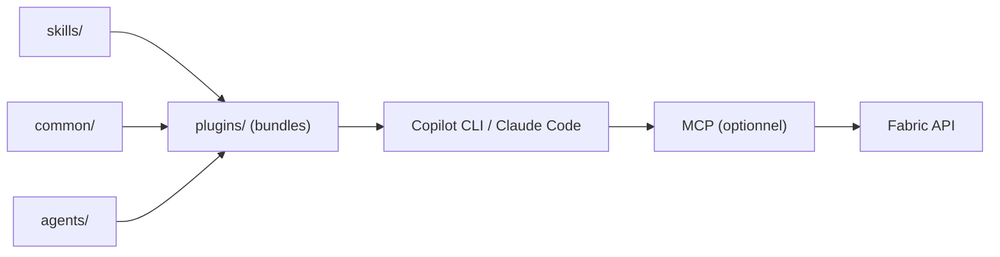

# microsoft/skills-for-fabric

> Markdown skills and agents that teach Copilot CLI and other coding assistants to work with Microsoft Fabric.

## The problem
A coding assistant knows little about Fabric's APIs, queries and best practices (Spark, SQL DW, KQL, Power BI).

## What it actually does
Content repository: skills, shared guidance and 5 agents (data engineer, admin, migration...) packaged in `fabric-skills` and `powerbi-authoring` bundles. Covers SQL warehouse, Spark/Lakehouse, semantic models, Eventhouse/KQL, Eventstreams, Dataflows Gen2, migrations and medallion. Optional MCP servers provide live access.

## How it is wired


## Trying it
```bash
/plugin marketplace add microsoft/skills-for-fabric
/plugin install fabric-skills@fabric-collection
az login
```

## Cost and gotchas
You need a Fabric tenant and Azure authentication (`az login`). A bundle is installed in full; APM (`apm install ... --skill`) lets you enable just one, but registers all the MCP servers.

## What it is not
Not a tool that executes anything: instructions only. Useless without a Fabric license.

## Alternatives
The README cites no alternative.

## For you
Worth watching: relevant if your data team is on Fabric; otherwise nothing to take from it.
