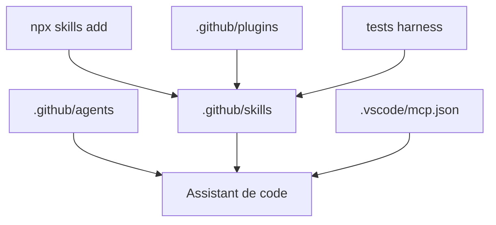

# microsoft/skills

> Skills, agents and MCP configurations for coding assistants working with the Azure SDKs and Microsoft Foundry.

## The problem
Coding assistants know the recent Azure SDKs poorly and mix up API patterns; they need a precise activation context.

## What it actually does
A catalog of about 175 skills by language (Python, .NET, TypeScript, Java, Rust) and by domain: Foundry, Cosmos DB, AI Search, Event Hubs, Key Vault, monitoring. It adds plugins, agents (backend, frontend, infrastructure, planner), an AGENTS.md template and MCP configurations. A test harness evaluates the generated code.

## How it is wired
Simplified diagram based on the sheet, no diagram provided.


## Trying it
```bash
npx skills add microsoft/skills
/plugin marketplace add microsoft/skills
/plugin install azure@skills
```

## Cost and gotchas
Free, MIT. The skills target paid Azure services that you would then use. The README asks you to load them selectively to avoid diluting the context. It says it is under active development; its end is truncated here.

## What it is not
Not an SDK: these are instructions for assistants. Not independent of Azure. The skill counts vary across README sections (174, 175).

## Alternatives
No alternative named in the README, apart from the microsoft/mcp repo for full Azure MCP servers.

## For you
Worth watching: the Foundry, azure-ai-ml and AI Search skills serve an MLOps profile on Azure, to be picked à la carte rather than installed as a whole.
