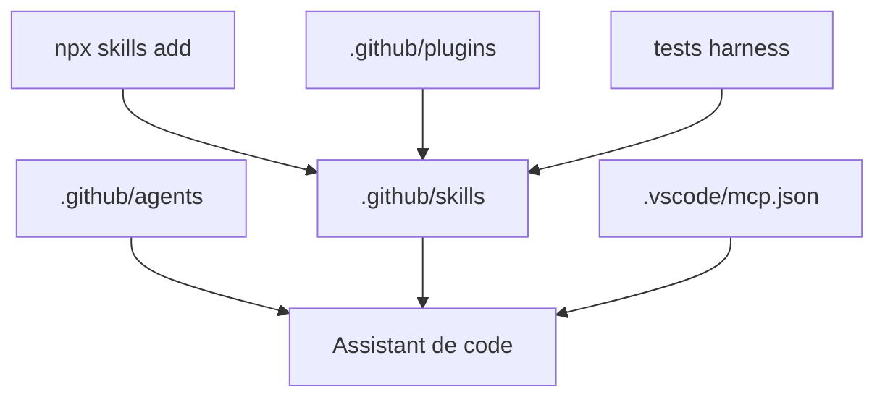

# microsoft/skills

> Skills, agents et configurations MCP pour assistants de code travaillant avec les SDK Azure et Microsoft Foundry.

## Le problème
Les assistants de code connaissent mal les SDK Azure récents et mélangent les motifs d'API ; il leur faut un contexte d'activation précis.

## Ce que ça fait vraiment
Un catalogue d'environ 175 skills par langage (Python, .NET, TypeScript, Java, Rust) et par domaine : Foundry, Cosmos DB, AI Search, Event Hubs, Key Vault, surveillance. Il ajoute des plugins, des agents (backend, frontend, infrastructure, planner), un modèle AGENTS.md et des configurations MCP. Un banc de tests évalue le code généré.

## Comment c'est branché
Schéma simplifié d'après la fiche, sans diagramme fourni.


## Essayer
```bash
npx skills add microsoft/skills
/plugin marketplace add microsoft/skills
/plugin install azure@skills
```

## Coût et pièges
Gratuit, MIT. Les skills ciblent des services Azure payants que tu utiliserais ensuite. Le README demande de les charger sélectivement pour éviter la dilution du contexte. Il se dit en développement actif ; sa fin est tronquée ici.

## Ce que ce n'est pas
Pas un SDK : ce sont des instructions pour assistants. Pas indépendant d'Azure. Les comptes des skills varient selon les sections du README (174, 175).

## Alternatives
Aucune alternative nommée dans le README, hors le dépôt microsoft/mcp pour les serveurs MCP Azure complets.

## Pour toi
À surveiller : les skills Foundry, azure-ai-ml et AI Search servent un profil MLOps sur Azure, à piocher à la carte plutôt qu'à installer en bloc.

