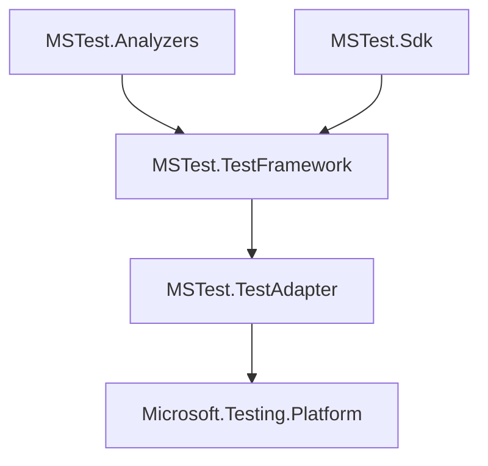

# microsoft/testfx

> MSTest test framework and Microsoft.Testing.Platform for testing .NET applications.

## The problem
Writing and running unit tests in .NET requires a framework and an execution engine.

## What it actually does
Hosts MSTest (writing tests, Test Explorer, suites) and Microsoft.Testing.Platform, presented as a lightweight alternative to VSTest. Shipped as NuGet packages: MSTest, TestFramework, TestAdapter, Analyzers and an MSBuild SDK. Targets .NET Framework, .NET Core, UWP and WinUI.

## How it is wired
Simplified diagram based on the sheet, no diagram provided.

## Trying it
No command documented in the README: add the MSTest NuGet package to a test project.

## Cost and gotchas
Free, but the .NET runtime is required; the README does not detail versions.

## What it is not
Not a Python or AI tool: a .NET test framework.

## Alternatives
VSTest, which Microsoft.Testing.Platform replaces in a lighter way.

## For you
Ignore: only useful for testing .NET code, outside the data or AI profile.
