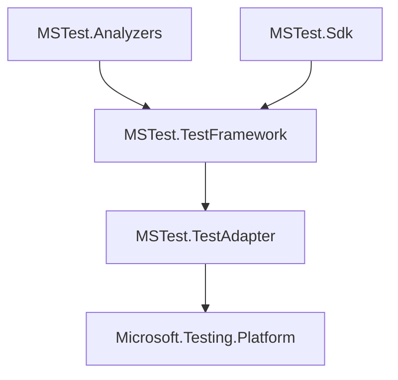

# microsoft/testfx

> Framework de test MSTest et plateforme Microsoft.Testing.Platform pour tester des applications .NET.

## Le problème
Écrire et exécuter des tests unitaires en .NET demande un framework et un moteur d'exécution.

## Ce que ça fait vraiment
Héberge MSTest (écrire des tests, Test Explorer, suites) et Microsoft.Testing.Platform, présenté comme une alternative légère à VSTest. Livré en paquets NuGet : MSTest, TestFramework, TestAdapter, Analyzers et un SDK MSBuild. Cible .NET Framework, .NET Core, UWP et WinUI.

## Comment c'est branché
Schéma simplifié d'après la fiche, sans diagramme fourni.

## Essayer
Aucune commande documentée dans le README : ajouter le paquet NuGet MSTest à un projet de test.

## Coût et pièges
Gratuit, mais le runtime .NET est nécessaire ; le README ne détaille pas les versions.

## Ce que ce n'est pas
Pas un outil Python ni d'IA : un framework de test .NET.

## Alternatives
VSTest, que Microsoft.Testing.Platform remplace de façon plus légère.

## Pour toi
À ignorer : utile seulement pour tester du code .NET, hors profil data ou IA.

