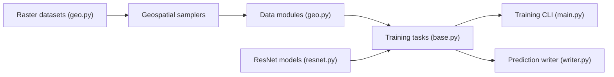

# microsoft/torchgeo

> PyTorch library of datasets, samplers and models for learning on geospatial data.

## The problem
Multispectral satellite imagery, differing projections and very large images make loading data for learning laborious.

## What it actually does
Provides geospatial datasets (Landsat, CDL…) that can be combined by union (`|`) and intersection (`&`) with automatic reprojection, patch samplers, benchmark datasets (VHR10, BigEarthNet, Chesapeake…) downloadable with checksum, pretrained multispectral weights and Lightning modules (datamodules, classification and segmentation tasks, MoCo, BYOL). A `torchgeo` CLI drives training and validation through a YAML config file.

## How it is wired


## Trying it
```bash
pip install torchgeo
torchgeo fit --config config.yaml
torchgeo validate --config config.yaml --ckpt_path=...
torchgeo test --config config.yaml --ckpt_path=...
```

## Cost and gotchas
Free. Satellite images are large (storage, possibly GPU); some datasets download automatically.

## What it is not
Not a data service: you have to obtain the Landsat or other images yourself, except for the downloadable datasets. Not a full GIS tool.

## Alternatives
- torchvision (cited as a point of comparison): without the geospatial part.
- timm: used with the weights in the example.

## For you
Adopt as soon as you touch Earth observation: API close to torchvision, Lightning integration, active Microsoft publication.
