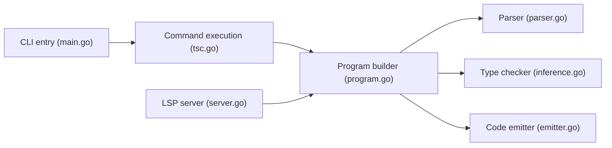

# microsoft/typescript-go

> Staging repository of the native TypeScript compiler in Go, now TypeScript 7, for TypeScript developers.

## The problem
The TypeScript compiler written in JavaScript becomes slow on large projects; this Go port aims for speed without changing results.

## What it actually does
- Compiles, checks and emits like `tsc` (parsing, types, JSX, declarations, watch, incremental build).
- Provides a language server (LSP) and a preview VS Code extension.
- The README announces the same error output as TypeScript 6.0; the API remains "not ready".
- The repository is the worksite: development continues in microsoft/TypeScript.

## How it is wired


## Trying it
```bash
npm install @typescript/native-preview
npx tsgo
```

## Cost and gotchas
Free. For TypeScript 7.0 RC and later, the command becomes `tsc`. The VS Code extension is configured with `js/ts.experimental.useTsgo`.

## What it is not
Not the active repository: "This Repo Is Closed", permanent archiving announced for September 2026. Not at full parity at the time of the README (LSP in progress, API not ready). An editor extension sends telemetry (diagram node).

## Alternatives
The original microsoft/TypeScript repository, where development continues.

## For you
Ignore: archived, and the follow-up is tracked in microsoft/TypeScript; useful only if you have large TypeScript projects on the front end.
