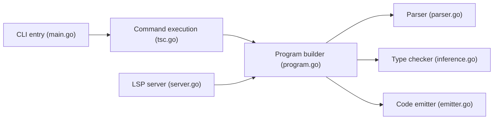

# microsoft/typescript-go

> Dépôt de transit du compilateur TypeScript natif en Go, devenu TypeScript 7, pour développeurs TypeScript.

## Le problème
Le compilateur TypeScript écrit en JavaScript devient lent sur les gros projets ; ce portage en Go vise la vitesse sans changer les résultats.

## Ce que ça fait vraiment
- Compile, vérifie et émet comme `tsc` (analyse, types, JSX, déclarations, watch, build incrémental).
- Fournit un serveur de langage (LSP) et une extension VS Code d'aperçu.
- Le README annonce la même sortie d'erreurs que TypeScript 6.0 ; l'API reste « not ready ».
- Le dépôt est le chantier : le développement continue dans microsoft/TypeScript.

## Comment c'est branché


## Essayer
```bash
npm install @typescript/native-preview
npx tsgo
```

## Coût et pièges
Gratuit. Pour TypeScript 7.0 RC et suivants, la commande devient `tsc`. L'extension VS Code se règle avec `js/ts.experimental.useTsgo`.

## Ce que ce n'est pas
Pas le dépôt actif : « This Repo Is Closed », archivage définitif annoncé en septembre 2026. Pas à parité complète au moment du README (LSP en cours, API pas prête). Une extension d'éditeur envoie de la télémétrie (nœud du diagramme).

## Alternatives
Le dépôt microsoft/TypeScript d'origine, où le développement continue.

## Pour toi
À ignorer : archivé, et la suite se suit dans microsoft/TypeScript ; utile seulement si tu as de gros projets TypeScript côté front.

