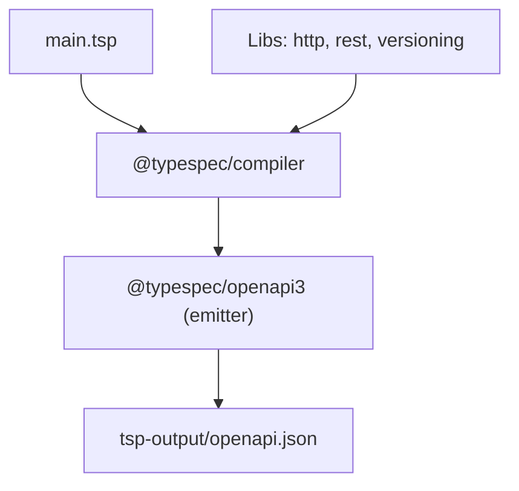

# microsoft/typespec

> Language for describing cloud service APIs and generating OpenAPI, clients and documentation.

## The problem
Maintaining an API's OpenAPI specification, clients and docs by hand makes them drift apart.

## What it actually does
You describe models and routes in TypeSpec, then emitters produce OpenAPI 3.0, client or server code and documentation. Libraries (http, rest, openapi3, versioning) and a linter framework enforce design rules. VS Code and Visual Studio extensions.

## How it is wired
Simplified diagram based on the sheet, no diagram provided.


## Trying it
```bash
npm install -g @typespec/compiler
tsp init
tsp install
tsp compile main.tsp --emit @typespec/openapi3
```

## Cost and gotchas
Free, Node required. Package versions are still 0.x in the README example, so breaking changes are possible. 1,056 open issues.

## What it is not
Not an API runtime framework. Not an ML model generator.

## Alternatives
No alternative named in the README (targets OpenAPI, gRPC).

## For you
Worth watching: useful if you expose model APIs and want a single spec, otherwise outside the core of data / AI / MLOps.
