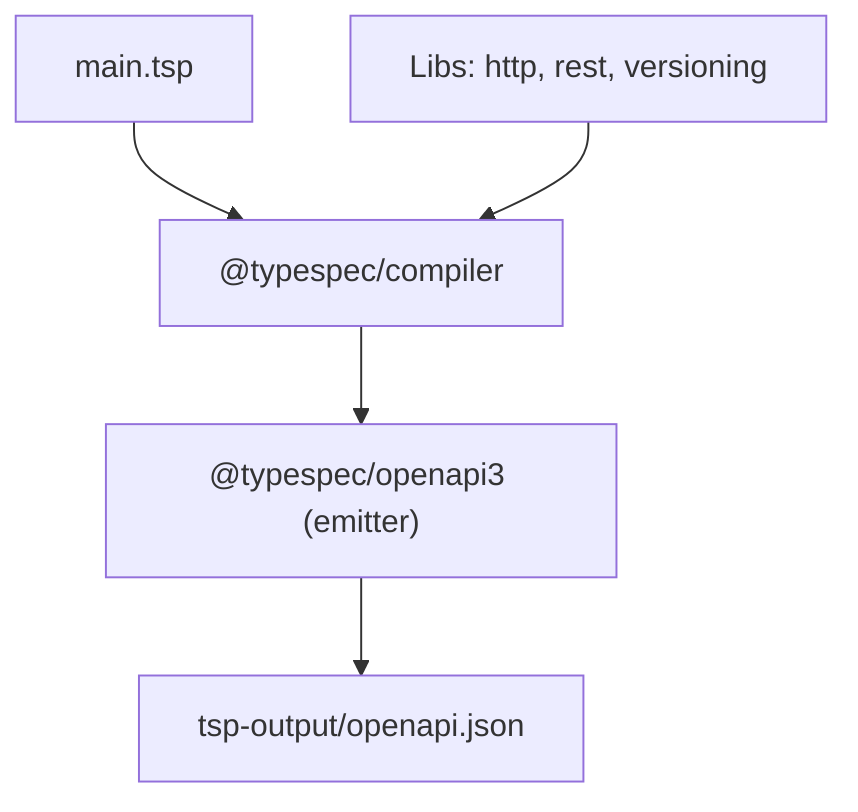

# microsoft/typespec

> Langage pour décrire des API de services cloud et générer OpenAPI, clients et documentation.

## Le problème
Maintenir à la main la spécification OpenAPI, les clients et la doc d'une API les fait diverger.

## Ce que ça fait vraiment
Tu décris modèles et routes en TypeSpec, puis des émetteurs produisent OpenAPI 3.0, du code client ou serveur et de la documentation. Des bibliothèques (http, rest, openapi3, versioning) et un framework de linter appliquent des règles de conception. Extensions VS Code et Visual Studio.

## Comment c'est branché
Schéma simplifié d'après la fiche, sans diagramme fourni.


## Essayer
```bash
npm install -g @typespec/compiler
tsp init
tsp install
tsp compile main.tsp --emit @typespec/openapi3
```

## Coût et pièges
Gratuit, Node requis. Les versions des paquets sont encore en 0.x dans l'exemple du README, donc des changements cassants sont possibles. 1 056 issues ouvertes.

## Ce que ce n'est pas
Pas un framework d'exécution d'API. Pas un générateur de modèles ML.

## Alternatives
Aucune alternative nommée dans le README (cible OpenAPI, gRPC).

## Pour toi
Surveiller : utile si tu exposes des API de modèles et veux une spec unique, sinon hors du cœur data / IA / MLOps.

