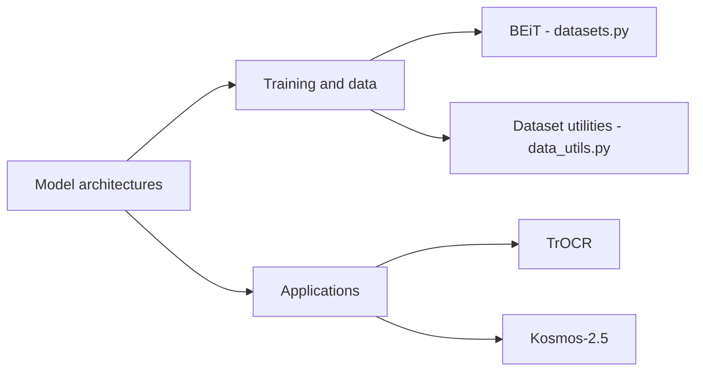

# microsoft/unilm

> Microsoft research portfolio on foundation models: LayoutLM, BEiT, WavLM, Kosmos, TrOCR and others.

## The problem
Getting access to the code and weights of many pre-training works (text, vision, speech, document) scattered across papers.

## What it actually does
It is not a single application: the README presents architectures (TorchScale, DeepNet, RetNet, BitNet, LongNet), models (UniLM, MiniLM, LayoutLM v1 to v3, BEiT 1 to 3, WavLM, VALL-E, Kosmos), toolkits and applications (TrOCR, LayoutReader). The sampled code notably shows the BEiT datasets and Fairseq multilingual loading.

## How it is wired

## Trying it
No command documented in the README: each sub-project has its own documentation.

## Cost and gotchas
Free; a GPU is needed for most. Heterogeneous: different environments and dependencies per subfolder. Release mentions in the README stop at 2022.

## What it is not
Not an installable library with a unified API. Some models are also available elsewhere.

## Alternatives
- TorchScale: library of foundation architectures (linked repo).

## For you
Worth watching: a gold mine of references, notably LayoutLM and TrOCR for document extraction, but you have to go to the sub-project you want.
