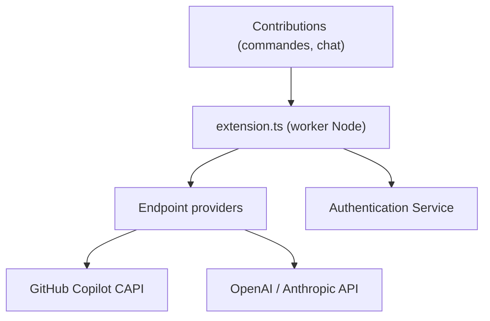

# microsoft/vscode-copilot-chat

> GitHub Copilot Chat extension for VS Code: agents, completions and chat built into the editor.

## The problem
Coding with an assistant means leaving the editor or copy-pasting context.

## What it actually does
Offers inline suggestions, a chat, targeted edits (Ctrl+I) and agents that edit files, run commands and fix their own errors. Supports custom instructions, skills, specialized agents and MCP servers. Development has moved to the main VS Code repository.

## How it is wired

## Trying it
No command documented in the README: the extension is activated in VS Code with a GitHub Copilot subscription (a free tier is possible).

## Cost and gotchas
Copilot subscription required, limited Free tier. This extension sends usage data to Microsoft (setting telemetry.telemetryLevel). Each version requires the latest VS Code.

## What it is not
Not a living project: the repository is archived. Not an offline or self-hosted solution.

## Alternatives
No alternative named in the README.

## For you
Ignore here: the repository is archived, follow microsoft/vscode; the tool remains useful but depends on the Copilot service.
