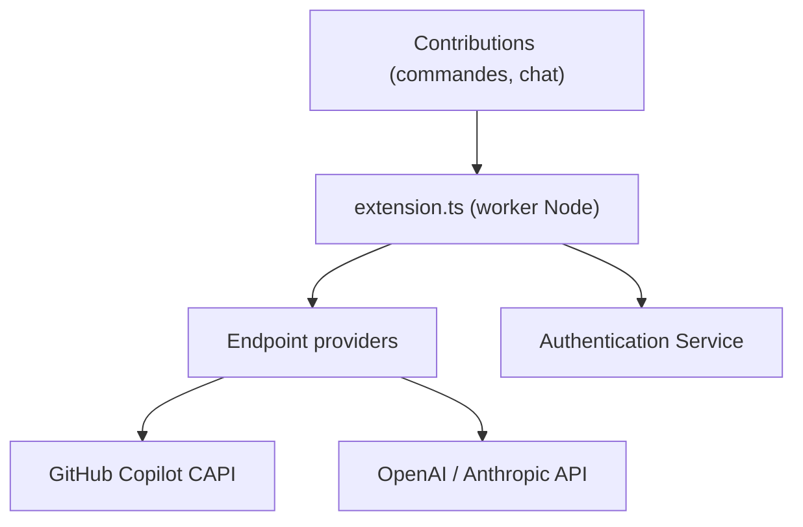

# microsoft/vscode-copilot-chat

> Extension GitHub Copilot Chat pour VS Code : agents, complétions et chat intégrés à l'éditeur.

## Le problème
Coder avec un assistant demande de quitter l'éditeur ou de copier-coller du contexte.

## Ce que ça fait vraiment
Propose des suggestions en ligne, un chat, des modifications ciblées (Ctrl+I) et des agents qui éditent des fichiers, lancent des commandes et corrigent leurs erreurs. Supporte des instructions personnalisées, des skills, des agents spécialisés et des serveurs MCP. Le développement a migré dans le dépôt principal de VS Code.

## Comment c'est branché

## Essayer
Aucune commande documentée dans le README : l'extension s'active dans VS Code avec un abonnement GitHub Copilot (offre gratuite possible).

## Coût et pièges
Abonnement Copilot requis, offre Free limitée. Cette extension envoie des données d'usage à Microsoft (réglage telemetry.telemetryLevel). Chaque version exige le dernier VS Code.

## Ce que ce n'est pas
Pas un projet vivant : le dépôt est archivé. Pas une solution hors ligne ni auto-hébergée.

## Alternatives
Aucune alternative nommée dans le README.

## Pour toi
À ignorer ici : le dépôt est archivé, suis microsoft/vscode ; l'outil reste utile mais dépend du service Copilot.

