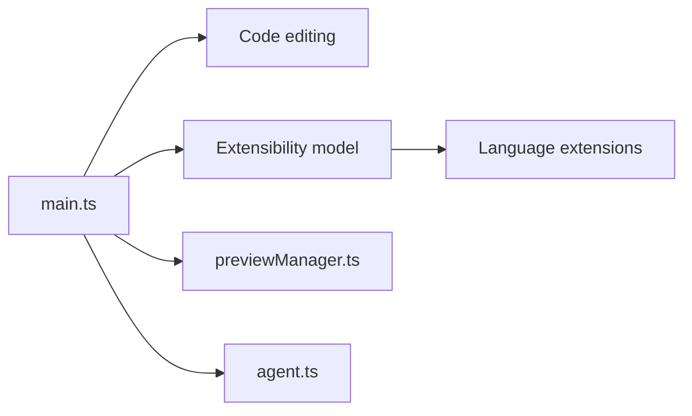

# microsoft/vscode

> "Code - OSS" repository, the open source base of the VS Code editor, for developers and contributors.

## The problem
A lightweight code editor must cover editing, navigation, debugging and extensions on three operating systems, with an open base.

## What it actually does
The repository is the product's source code, under MIT. The VS Code that is distributed is a variant under a Microsoft licence. It provides editing, navigation, light debugging, built-in extensions (grammars, language support) and a development container. The architecture also lists an agent host, search, authentication, Copilot and Markdown preview; their links are not detailed.

## How it is wired


## Trying it
```bash
# aucune commande documentée dans le README (conteneur de développement : 4 cœurs, 6 Go de RAM minimum)
```

## Cost and gotchas
Free. A full build requires at least 4 cores and 6 GB of RAM (8 recommended). The Microsoft product differs from the MIT repository.

## What it is not
Not the official turnkey VS Code: that one has customisations under a Microsoft licence. It is not a tool you install from this repository.

## Alternatives
No alternative named in the README.

## For you
Worth watching: you probably already use it; this repository is only worth it for reading the code or contributing.
