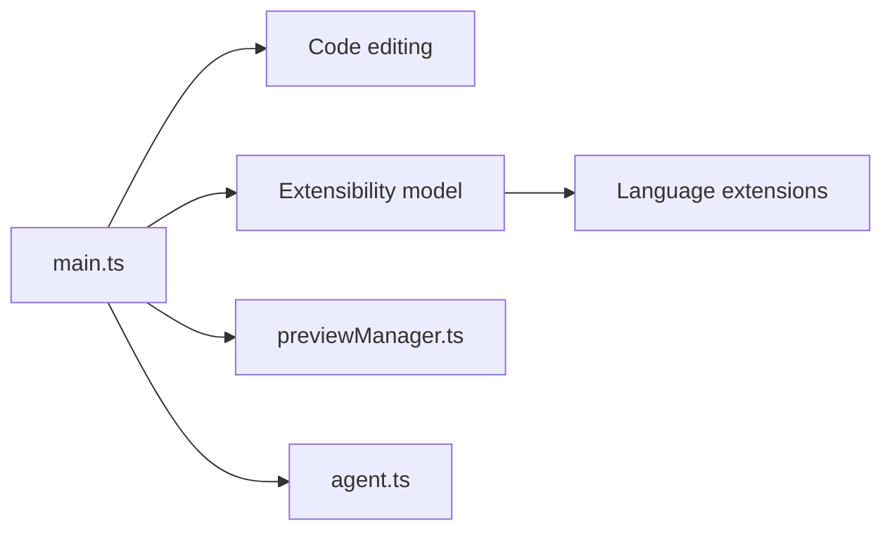

# microsoft/vscode

> Dépôt « Code - OSS », la base open source de l'éditeur VS Code, pour développeurs et contributeurs.

## Le problème
Un éditeur de code léger doit couvrir édition, navigation, débogage et extensions sur trois systèmes, avec une base ouverte.

## Ce que ça fait vraiment
Le dépôt est le code source du produit, sous MIT. Le VS Code distribué est une variante sous licence Microsoft. Il fournit édition, navigation, débogage léger, extensions intégrées (grammaires, support de langages) et un conteneur de développement. L'architecture liste aussi hôte d'agents, recherche, authentification, Copilot et aperçu Markdown ; leurs liens ne sont pas détaillés.

## Comment c'est branché


## Essayer
```bash
# aucune commande documentée dans le README (conteneur de développement : 4 cœurs, 6 Go de RAM minimum)
```

## Coût et pièges
Gratuit. Un build complet demande au moins 4 cœurs et 6 Go de RAM (8 recommandés). Le produit Microsoft diffère du dépôt MIT.

## Ce que ce n'est pas
Pas le VS Code officiel clé en main : celui-ci a des personnalisations sous licence Microsoft. Ce n'est pas un outil que tu installes depuis ce dépôt.

## Alternatives
Aucune alternative nommée dans le README.

## Pour toi
À surveiller : tu l'utilises sans doute déjà, ce dépôt ne vaut que pour lire le code ou contribuer.

