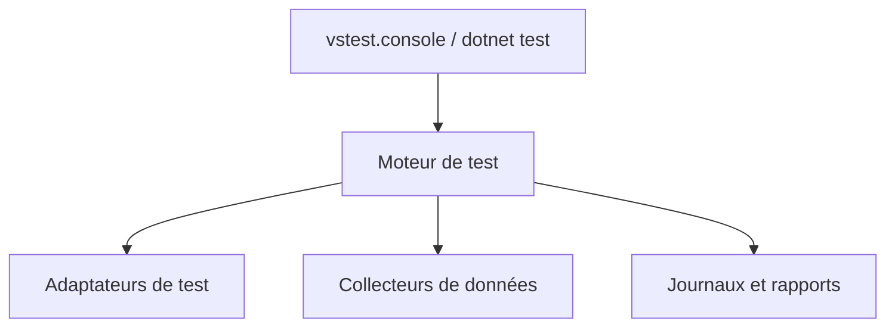

# microsoft/vstest

> Visual Studio test platform: runs .NET tests, collects diagnostics through adapters.

## The problem
Each test framework (MSTest, NUnit, xUnit) would need its own execution engine.

## What it actually does
Provides an extensible engine: test discovery and execution, collection of diagnostic and coverage data, reports. Frameworks plug in through adapters, shipped as vsix or NuGet. The README mostly points to a long list of documents: protocols, SDK, filters, `.runsettings`.

## How it is wired

Simplified diagram based on the sheet, no diagram provided.

## Trying it
```bash
# Aucune commande dans le README : voir le Quickstart et les options en ligne de commande.
```

## Cost and gotchas
Free, but tied to the .NET ecosystem and Visual Studio. 85 open issues.

## What it is not
Not a framework for writing tests: only the engine that runs them.

## Alternatives
No alternative named in the README.

## For you
Ignore: an internal component of the .NET chain, outside the Python/AI scope.
