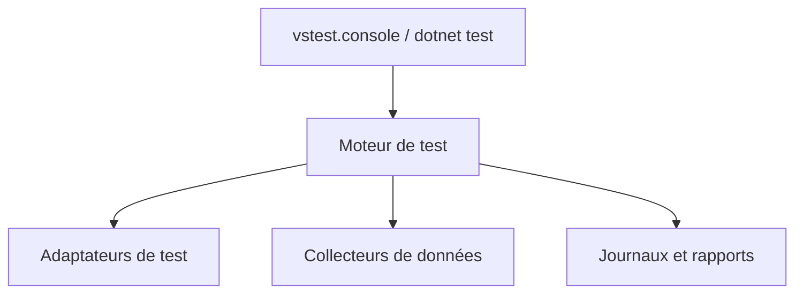

# microsoft/vstest

> Plateforme de tests de Visual Studio : exécute des tests .NET, collecte des diagnostics via des adaptateurs.

## Le problème
Chaque framework de test (MSTest, NUnit, xUnit) aurait besoin de son propre moteur d'exécution.

## Ce que ça fait vraiment
Fournit un moteur extensible : découverte et exécution des tests, collecte de données de diagnostic et de couverture, rapports. Les frameworks se branchent par des adaptateurs, livrés en vsix ou NuGet. Le README renvoie surtout à une longue liste de documents : protocoles, SDK, filtres, `.runsettings`.

## Comment c'est branché

Schéma simplifié d'après la fiche, sans diagramme fourni.

## Essayer
```bash
# Aucune commande dans le README : voir le Quickstart et les options en ligne de commande.
```

## Coût et pièges
Gratuit, mais lié à l'écosystème .NET et à Visual Studio. 85 tickets ouverts.

## Ce que ce n'est pas
Pas un framework d'écriture de tests : seulement le moteur qui les lance.

## Alternatives
Aucune alternative nommée dans le README.

## Pour toi
Ignorer : composant interne de la chaîne .NET, hors périmètre Python/IA.

