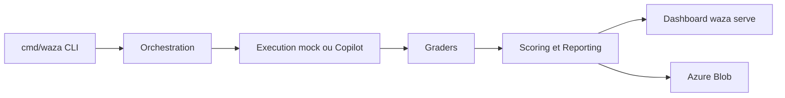

# microsoft/waza

> Go CLI to evaluate AI agent skills: evaluation suites, benchmarks and model comparison.

## The problem
A skill (`SKILL.md`) triggers poorly or degrades the response without anyone noticing, for lack of reproducible tests.

## What it actually does
Generates skill and evaluation skeletons, runs tasks on a `mock` engine or the Copilot SDK, applies graders (text, file, diff, behavior, action sequence, LLM judge), compares models, replays snapshots, runs adversarial tests (prompt injection), measures tokens. A dashboard (`waza serve`) displays results; upload to Azure Blob is possible.

## How it is wired


## Trying it
```bash
curl -fsSL https://raw.githubusercontent.com/microsoft/waza/main/install.sh | bash
waza init my-project && cd my-project
waza new skill my-skill
waza run my-skill
waza check my-skill
waza compare results-gpt4.json results-sonnet.json
```

## Cost and gotchas
The default engine requires Copilot authentication (`GITHUB_TOKEN` in CI) or a provider configured through `COPILOT_*` variables; `mock` mode needs no key. The CLI checks for updates in the background (can be disabled with `WAZA_NO_UPDATE_CHECK=1`). Building from source: Go 1.26 and Git LFS.

## What it is not
Not a general-purpose model benchmark: it tests skills and agents. The grader search in the registry still returns examples shipped with the tool.

## Alternatives
No alternative named in the README.

## For you
Adopt: if you write agent skills, the `mock` mode and the exit code for CI let you test them without a key.
