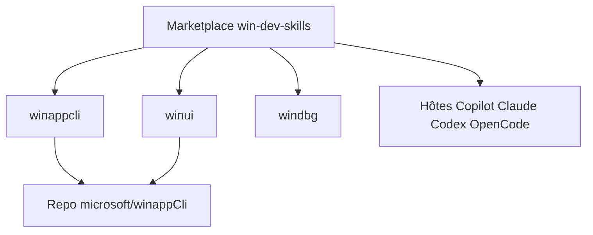

# microsoft/win-dev-skills

> Catalog of plugins for coding agents, to develop and debug Windows applications.

## The problem
A coding agent knows little about MSIX packaging, WinUI 3 or WinDbg debugging. Each host installs its plugins differently.

## What it actually does
A marketplace of three plugins: `winappcli` (packaging, signing, Store), `winui` (WinUI 3 and Windows App SDK applications) and `windbg` (diagnosing applications, user-mode and kernel drivers). It installs on Copilot CLI, Claude Code, Codex, OpenClaw and OpenCode. The first two plugins are maintained in microsoft/winappCli.

## How it is wired
Simplified diagram based on the sheet, no diagram supplied.



## Trying it
```bash
claude plugin marketplace add microsoft/win-dev-skills
claude plugin install <plugin>@win-dev-skills
```

## Cost and gotchas
Free. Git required. WinUI needs .NET SDK ≥ 8.0.100, WinApp CLI ≥ 0.7.0 and Windows developer mode. On Codex, OpenClaw and OpenCode, only skills load, not agents.

## What it is not
It is not useful outside Windows. Installing the same plugin from two catalogs creates duplicate skills.

## Alternatives
- microsoft/winappCli: the repo that maintains `winappcli` and `winui`.
- awesome-copilot: ships the same plugins.

## For you
Watch: no direct value for data/AI, but a good example of a multi-host skills marketplace if you develop on Windows.
