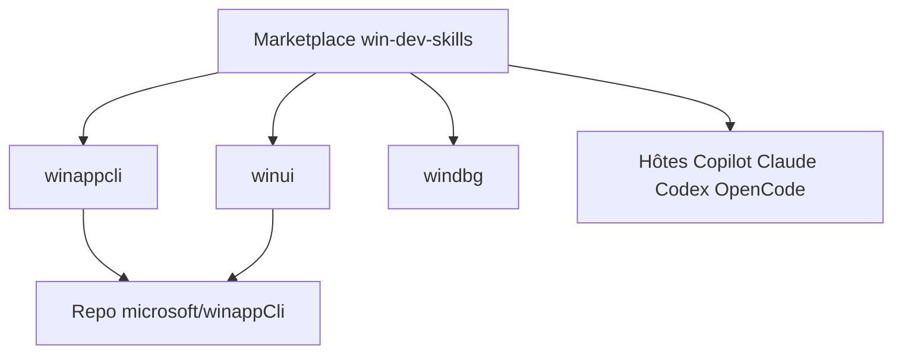

# microsoft/win-dev-skills

> Catalogue de plugins pour agents de code, afin de développer et déboguer des applications Windows.

## Le problème
Un agent de code connaît mal l'empaquetage MSIX, WinUI 3 ou le débogage WinDbg. Chaque hôte installe ses plugins différemment.

## Ce que ça fait vraiment
Marketplace de trois plugins : `winappcli` (empaquetage, signature, Store), `winui` (applications WinUI 3 et Windows App SDK) et `windbg` (diagnostic d'applications, pilotes utilisateur et noyau). Il s'installe sur Copilot CLI, Claude Code, Codex, OpenClaw et OpenCode. Les deux premiers plugins sont maintenus dans microsoft/winappCli.

## Comment c'est branché
Schéma simplifié d'après la fiche, sans diagramme fourni.



## Essayer
```bash
claude plugin marketplace add microsoft/win-dev-skills
claude plugin install <plugin>@win-dev-skills
```

## Coût et pièges
Gratuit. Git requis. WinUI demande .NET SDK ≥ 8.0.100, WinApp CLI ≥ 0.7.0 et le mode développeur Windows. Sur Codex, OpenClaw et OpenCode, seuls les skills se chargent, pas les agents.

## Ce que ce n'est pas
Ce n'est pas utile hors de Windows. Installer le même plugin depuis deux catalogues crée des skills en double.

## Alternatives
- microsoft/winappCli : le dépôt qui maintient `winappcli` et `winui`.
- awesome-copilot : livre les mêmes plugins.

## Pour toi
À surveiller : sans valeur directe pour data/IA, mais bon exemple de marketplace de skills multi-hôtes si tu développes sous Windows.

