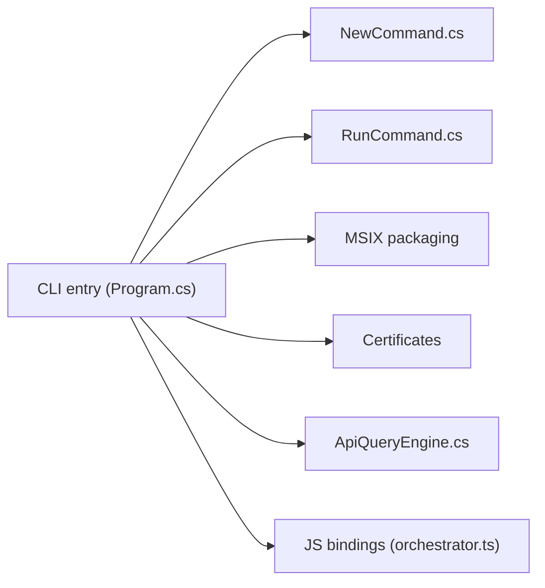

# microsoft/winappCli

> Microsoft CLI to manage the Windows SDK, app identity, manifests, certificates and MSIX packages from any framework.

## The problem
Cross-platform apps (Electron, Qt, Rust) cannot easily obtain the package identity required by modern Windows APIs.

## What it actually does
`winapp init` sets up the SDK and App SDK; `pack` produces MSIX packages; `create-debug-identity` adds a temporary identity to an executable; `cert` and `sign` manage certificates. `find-api` and `find-ui` query WinUI APIs and samples for agents. An agent plugin + skills is distributed for Copilot CLI and Claude Code. Status "Public Preview".

## How it is wired


## Trying it
```bash
winget install Microsoft.winappcli --source winget
winapp --help
npm install @microsoft/winappcli --save-dev
npx winapp --help
```

## Cost and gotchas
Free, Windows. The `main` branch is under active development and may differ from published releases. Development certificates and developer mode modify the machine (see the security guide). The README is truncated at the end (build section and a closing block with no opening).

## What it is not
Not a cross-platform or stable tool: the README says "experimental". It is not a compiler: it prepares identity and packaging.

## Alternatives
No alternative named in the README.

## For you
Ignore: Windows packaging outside your data/AI stack; only the Claude Code plugin could be useful if you publish a Windows app.
