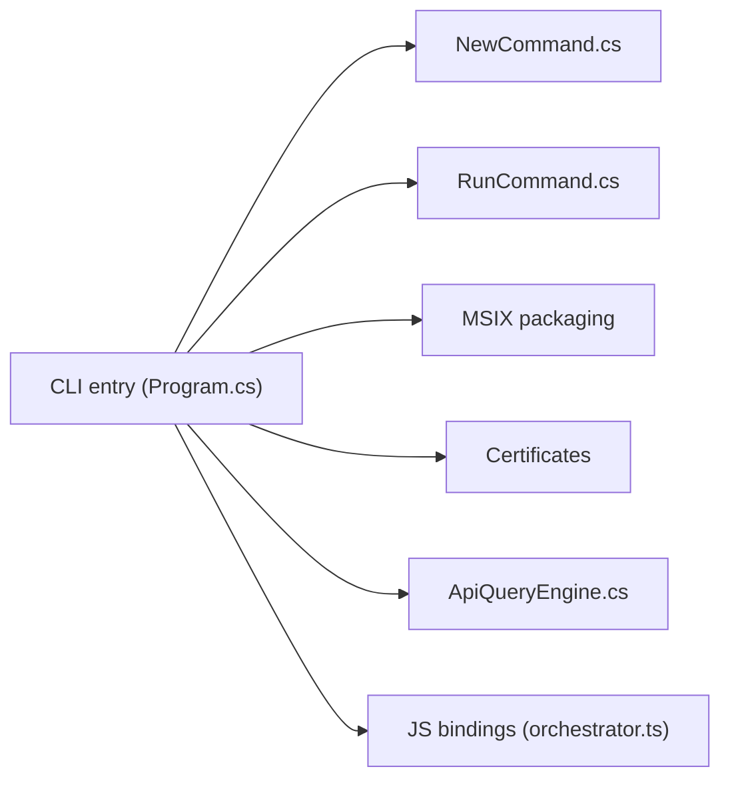

# microsoft/winappCli

> CLI Microsoft pour gérer SDK Windows, identité d'application, manifestes, certificats et paquets MSIX depuis n'importe quel framework.

## Le problème
Les applications multiplateformes (Electron, Qt, Rust) n'obtiennent pas facilement l'identité de paquet nécessaire aux API Windows modernes.

## Ce que ça fait vraiment
`winapp init` configure SDK et App SDK ; `pack` produit des MSIX ; `create-debug-identity` ajoute une identité temporaire à un exécutable ; `cert` et `sign` gèrent les certificats. `find-api` et `find-ui` interrogent les API et exemples WinUI pour des agents. Un plugin agent + skills est distribué pour Copilot CLI et Claude Code. Statut « Public Preview ».

## Comment c'est branché


## Essayer
```bash
winget install Microsoft.winappcli --source winget
winapp --help
npm install @microsoft/winappcli --save-dev
npx winapp --help
```

## Coût et pièges
Gratuit, Windows. La branche `main` est en développement actif et peut différer des versions publiées. Les certificats de développement et le mode développeur modifient la machine (voir le guide de sécurité). Le README est tronqué en fin de document (section de build et fermeture de bloc sans ouverture).

## Ce que ce n'est pas
Pas un outil multiplateforme ni stable : le README parle d'« expérimental ». N'est pas un compilateur : il prépare identité et paquet.

## Alternatives
Aucune alternative nommée dans le README.

## Pour toi
À ignorer : packaging Windows hors de ta pile data/IA ; seul le plugin pour Claude Code pourrait servir si tu publies une app Windows.

