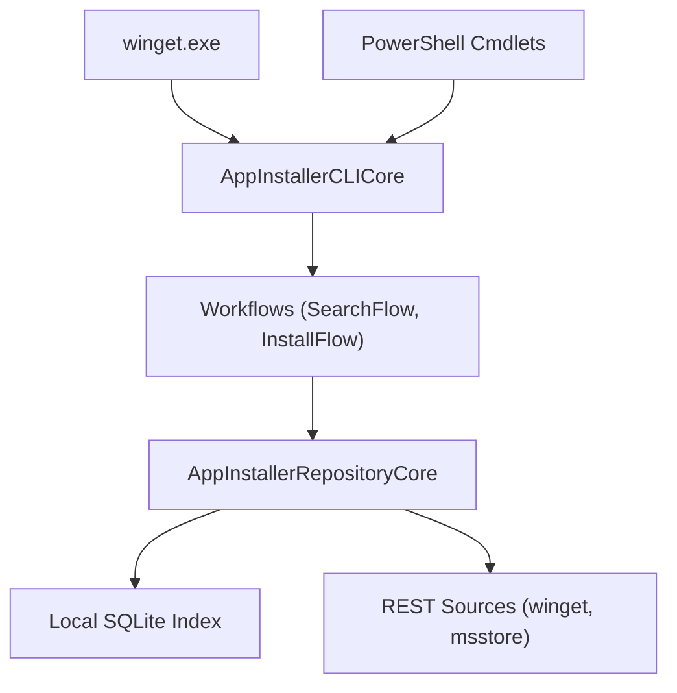

# microsoft/winget-cli

> Command-line client of Windows Package Manager, for installing software on Windows.

## The problem
Installing and updating Windows applications by hand, one by one, from websites.

## What it actually does
The `winget` client queries sources: "winget" (community repository), "msstore" (Microsoft Store) or a private REST source. It installs, lists and updates packages. A PowerShell module (Microsoft.WinGet.Client) exposes the same operations as cmdlets. The code is in C++ with COM servers in C#.

## How it is wired


## Trying it
```bash
winget install <package>
winget features
```
```powershell
Install-Module -Name Microsoft.WinGet.Client
Find-WinGetPackage -Query "Visual Studio Code"
```

## Cost and gotchas
Free. Requires Windows 10 1809, Windows 11 or Windows Server 2025. The client sends usage data to Microsoft (can be disabled via the privacy settings); a self-compiled build sends none.

## What it is not
Not a Linux or macOS solution. The README states that clients built outside the official channels are not fully supported. No graphical interface.

## Alternatives
No alternative named in the README.

## For you
Watch: relevant only if you administer Windows machines, with no direct link to data or MLOps.
