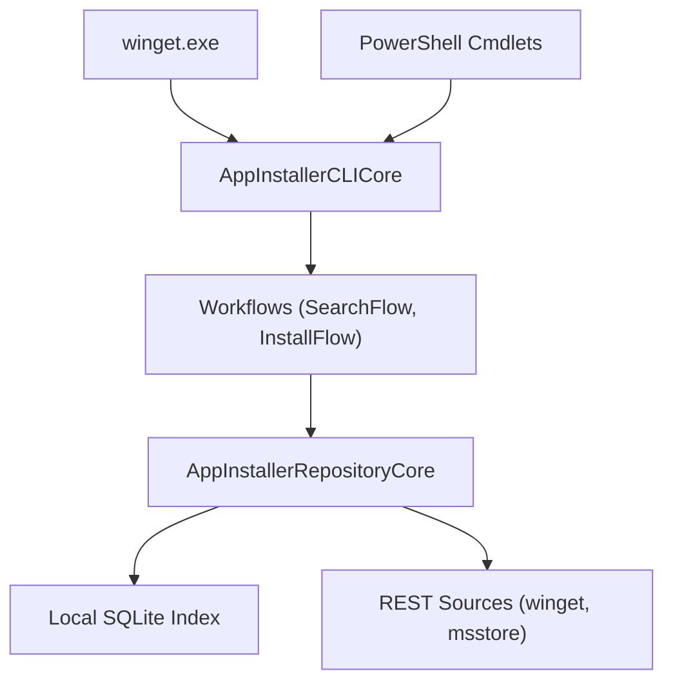

# microsoft/winget-cli

> Client en ligne de commande de Windows Package Manager, pour installer des logiciels sous Windows.

## Le problème
Installer et mettre à jour des applications Windows à la main, une par une, depuis des sites web.

## Ce que ça fait vraiment
Le client `winget` interroge des sources : « winget » (dépôt communautaire), « msstore » (Microsoft Store) ou une source REST privée. Il installe, liste et met à jour les paquets. Un module PowerShell (Microsoft.WinGet.Client) expose les mêmes opérations en cmdlets. Le code est en C++ avec des serveurs COM en C#.

## Comment c'est branché


## Essayer
```bash
winget install <package>
winget features
```
```powershell
Install-Module -Name Microsoft.WinGet.Client
Find-WinGetPackage -Query "Visual Studio Code"
```

## Coût et pièges
Gratuit. Nécessite Windows 10 1809, Windows 11 ou Windows Server 2025. Le client envoie des données d'usage à Microsoft (désactivables via les paramètres de confidentialité) ; une version compilée soi-même n'en envoie pas.

## Ce que ce n'est pas
Pas une solution Linux ou macOS. Le README précise que les clients compilés hors des canaux officiels ne sont pas pleinement supportés. Pas d'interface graphique.

## Alternatives
Aucune alternative nommée dans le README.

## Pour toi
À surveiller : pertinent seulement si tu administres des postes Windows, sans lien direct avec la data ou le MLOps.

